<p align="center">
  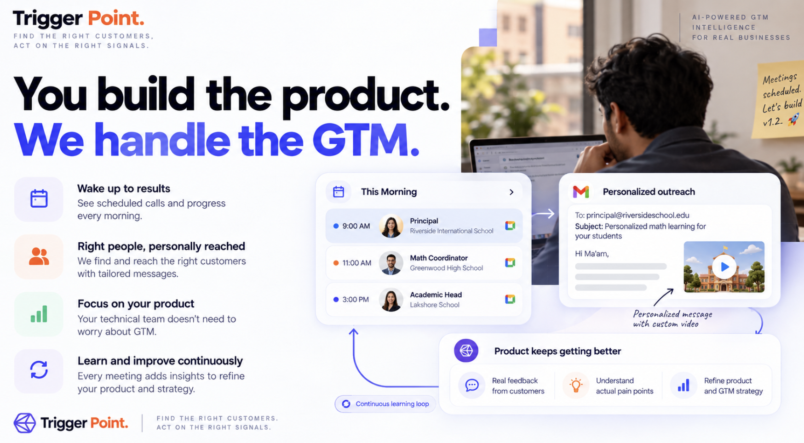
</p>

# Trigger Point

**You build the product. Trigger Point handles the go-to-market.**

A founder gives one website and one goal. Trigger Point finds the right buyers, finds the reason to contact each buyer now, writes the message, sends it, reads the reply, and books the meeting. After each meeting, it learns and proposes a better plan.

Every claim in a message has a source. If an account has no proof, Trigger Point rejects the account and says why.

<p align="center">
  &nbsp;&nbsp;&nbsp;
  &nbsp;&nbsp;&nbsp;
  &nbsp;&nbsp;&nbsp;
  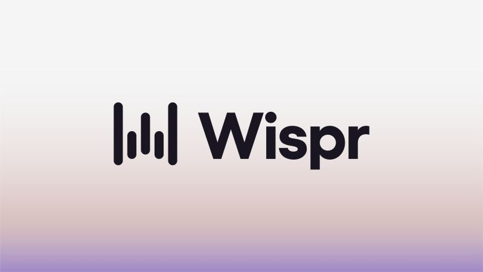
</p>

**Contents:** [The service](#the-service) · [What it does now](#what-it-does-now) · [What it could do next](#what-it-could-do-next) · [How to run it](#how-to-run-it) · [How it is built](#how-it-is-built) · [The approaches we tried](#the-approaches-we-tried) · [More help](#more-help)

---

## The service

### The job
Trigger Point does the outbound sales work of a small product company. This work has five parts:

1. Decide who to sell to.
2. Find the reason each buyer needs the product now.
3. Reach the right person with a true, specific message.
4. Read the reply and book the meeting.
5. Learn from the result, and improve the plan.

### Who does this job today
- The founder does it by hand. Founders of technical products have little time and little sales experience.
- A company hires sales staff or an agency. This costs money each month before the first meeting.
- Tools help with one part only. A list builder finds names. A sequencer sends mail. A person must still decide who to contact and why.

Most tools send the same message to a long list. Buyers ignore these messages. Trigger Point does the opposite. It contacts few accounts, and each message states a real, dated reason.

### Who pays
The founder or the company that sells the product. The service replaces a sales hire for the first customers. It also replaces the weekly work of list building and message writing.

### The example we built it for
Tulip is an AI maths tutor for school classes 6 to 10. Its first buyers are schools in Powai, Mumbai. The founders write code. They do not want to write cold email.

For Tulip, a good reason to write is public: a teacher or principal posts about AI in class. Trigger Point looks for these posts, checks them, and uses them in the message. The same flow works for any product. The Tulip case is the first test.

### Three rules that make it trustworthy
- **Evidence first.** Each account must answer four questions: Why this account? Why this person? Why now? Why us? If it cannot, it is rejected with a reason.
- **Code scores, not the model.** A model reads and writes. Deterministic code calculates every score and every check.
- **A person decides strategy.** Autopilot handles routine steps. A founder approves each change to strategy.

---

## What it does now

The founder enters a website and a goal once. After that, Autopilot runs the work. Each screen below comes from the running product.

<p align="center">
  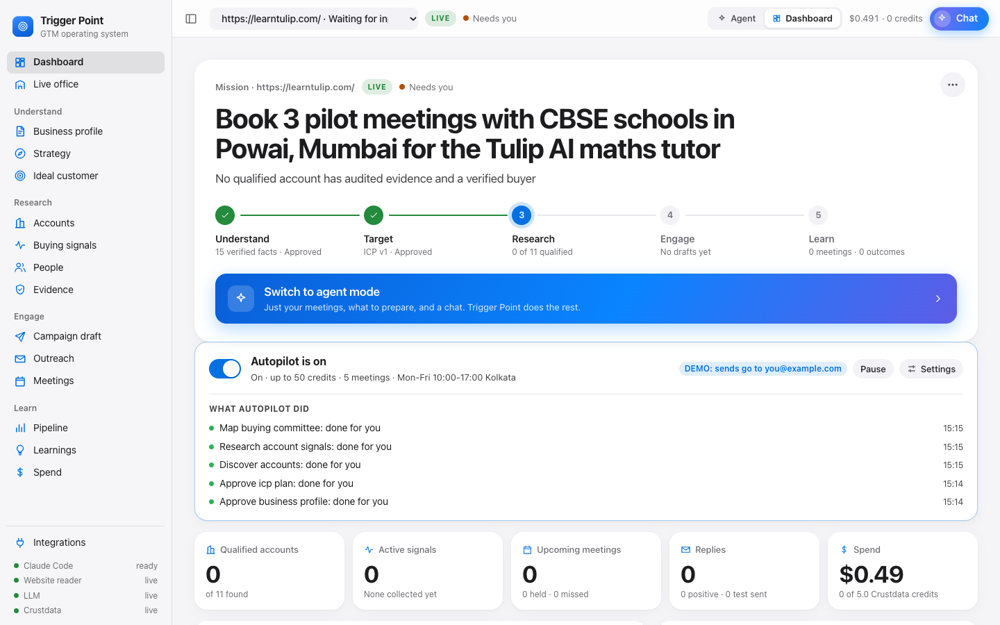
</p>
<p align="center"><em>The Dashboard. Real run for Tulip: schools in Powai. The stages show where the mission is. The list shows what Autopilot did without a click.</em></p>

### End to end, with no click from the founder

| Step | What Trigger Point does | Where a person is still needed |
|---|---|---|
| 1. Understand | Reads the website. Builds a profile where each fact has a source. | None under Autopilot. |
| 2. Plan | Builds the strategy and the ideal customer profile (ICP). Checks the ICP against Crustdata names. | The founder approves later changes to strategy. |
| 3. Find accounts | Searches Crustdata for matching companies. Widens a narrow place step by step. | None. |
| 4. Find signals | Collects dated signals: hiring, headcount, funding, and staff posts about a topic. | None. |
| 5. Find people | Finds the person who owns the problem. Looks up contact details when the Crustdata key allows it. | None. |
| 6. Score | Calculates a score with code. Rejects accounts that lack fresh proof. | None. |
| 7. Write | Writes one message per person. A checker verifies each claim against its source. | None under Autopilot. |
| 8. Send | Schedules and sends inside the allowed hours, through Gmail. | The test inbox only. Real recipients are off. |
| 9. Reply | Reads each reply. Records a "no" with its reason. Stops mail to opt-outs. | None. |
| 10. Book | Offers times that fit the founder's Google Calendar. Creates the meeting with a Meet link. | Built, not yet proven live (see below). |
| 11. Learn | Imports meeting notes. Compares what worked. Proposes a plan for the next campaign. | The founder approves every change. |

### See the evidence behind every message
<p align="center">
  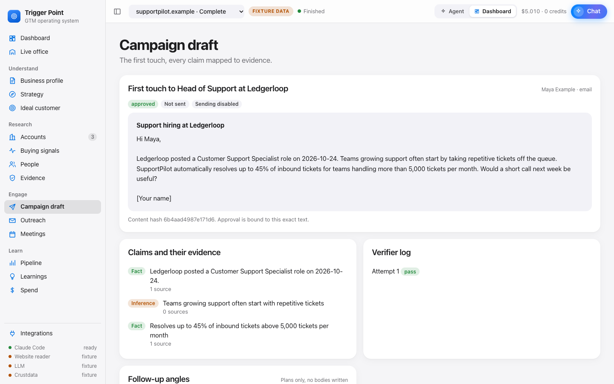
</p>
<p align="center"><em>A draft. Each claim is labelled Fact or Inference and linked to its source. The verifier log shows the check.</em></p>

### The agents at work
<p align="center">
  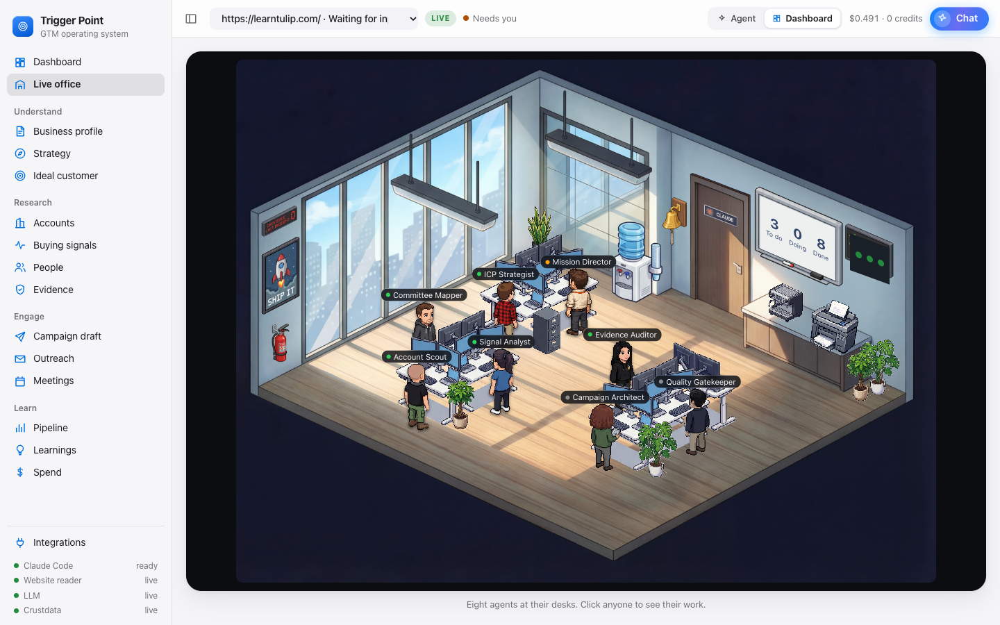
</p>
<p align="center"><em>The Live office. Eight Claude Code agents. Nothing moves on screen unless real work happened.</em></p>

### Accounts with honest rejections
<p align="center">
  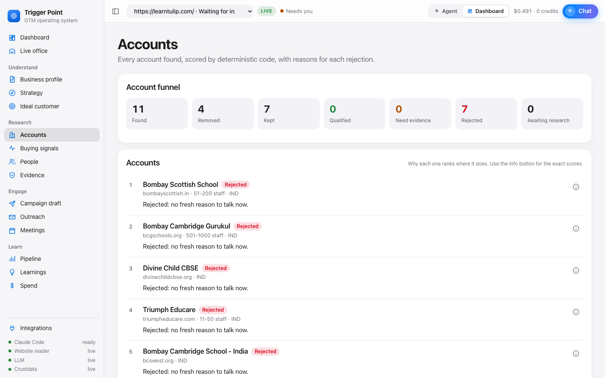
</p>
<p align="center"><em>Real Powai schools from Crustdata. Each rejection has a reason. The score has a breakdown.</em></p>

### Outreach, replies, and the reason to write now
<p align="center">
  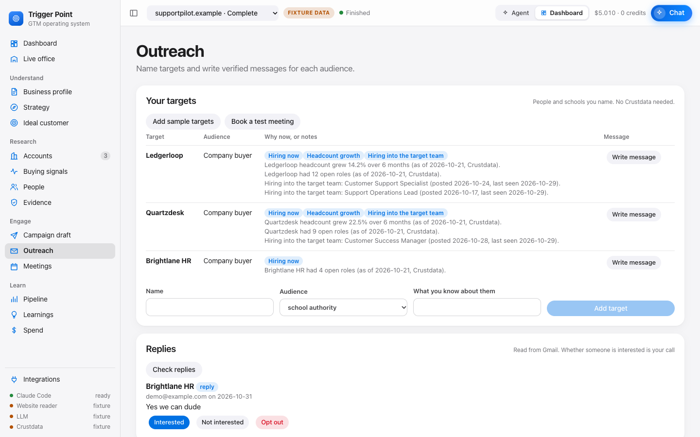
</p>
<p align="center"><em>Each target shows its dated reason. A real reply is read from Gmail and stored without the quoted text.</em></p>

### Learn from each result, then plan the next campaign
<p align="center">
  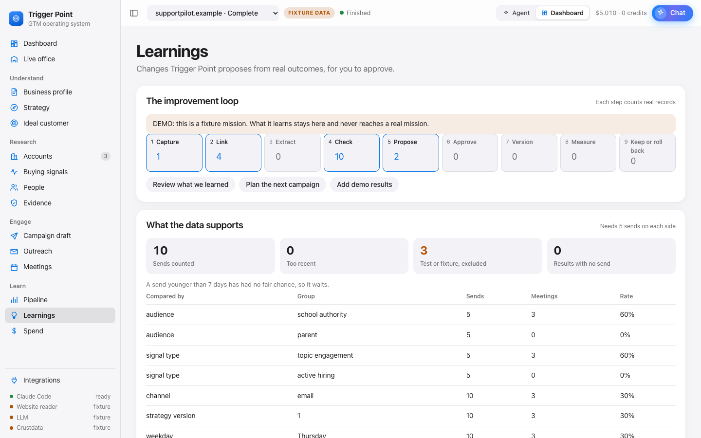
</p>
<p align="center"><em>The nine-step loop: capture, link, extract, check, propose, approve, version, measure, and keep or roll back. This screen uses labelled demo data.</em></p>

<p align="center">
  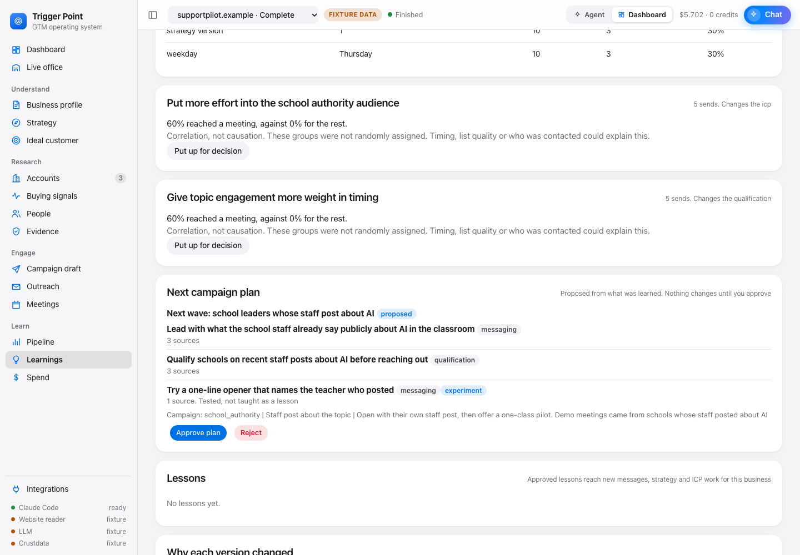
</p>
<p align="center"><em>The next-campaign plan. Each change lists its sources. A change with one source is an experiment. The founder approves the plan.</em></p>

The loop follows these rules:
- A change needs two or more independent sources to become a lesson.
- One source only creates an experiment. An experiment is tested, not taught.
- Test sends and demo data never teach.
- One target in five stays out of each change, as a comparison group.

### Control and quiet mode
<p align="center">
  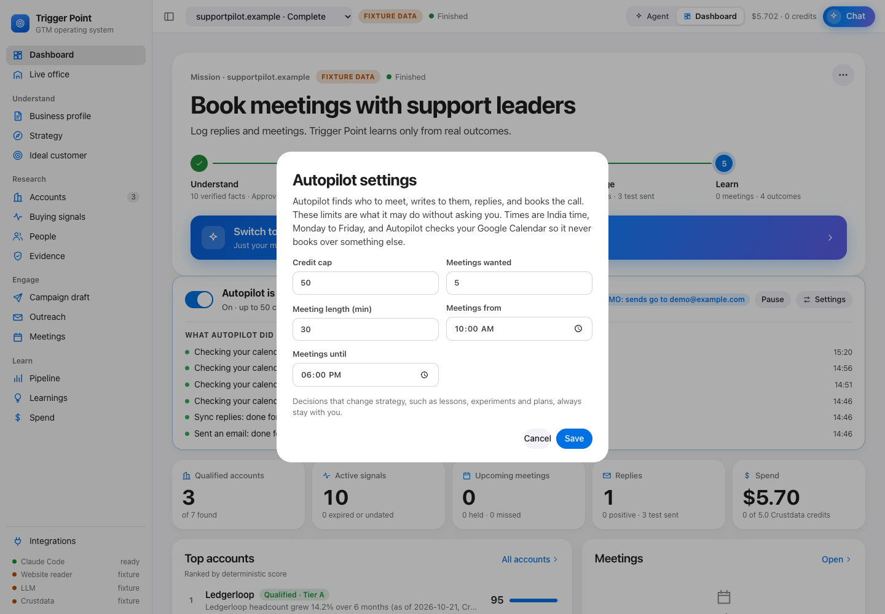&nbsp;
  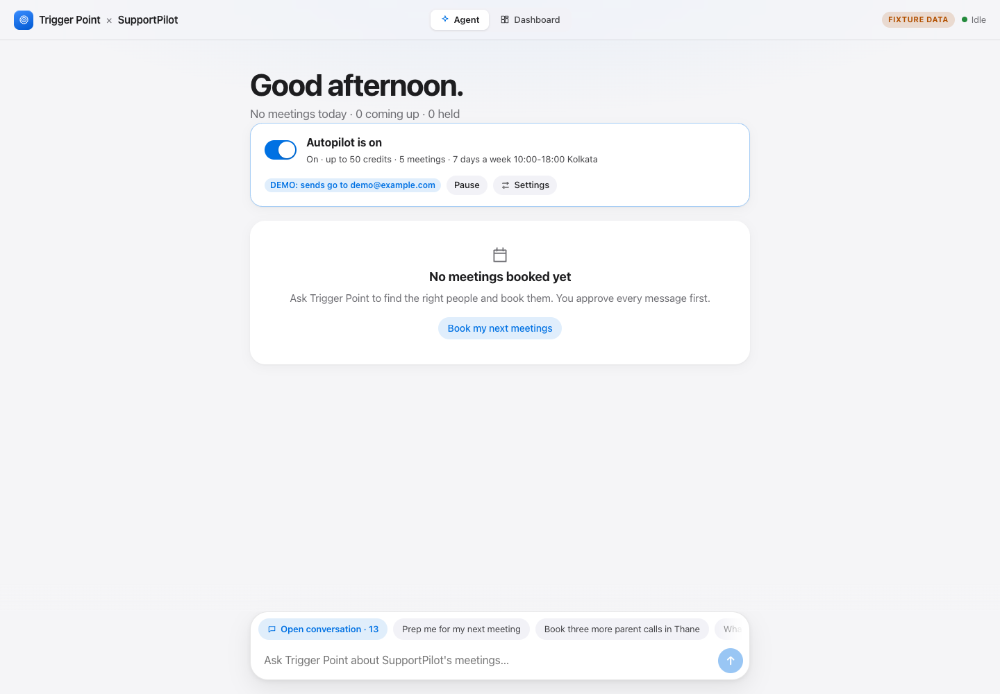
</p>
<p align="center"><em>Left: the limits Autopilot may use without asking. Right: agent mode. It shows only meetings, what to prepare, and a chat.</em></p>

### What we proved on real accounts
We ran each item below with real services. We list the result as it is.

| Result | Status |
|---|---|
| Live mission for Tulip: one website and one goal, then profile, ICP, accounts, signals, people, and scores. No click. | Proven live |
| Fixture mission with live Gmail: three messages written, verified, approved, scheduled, and sent to the test inbox. No click. | Proven live |
| A real reply read from Gmail, stored without the quoted text. | Proven live |
| Eight real Tulip meetings imported from Wispr Flow. 43 insights, each with a checked quote. | Proven live |
| Three candidate lessons and one next-campaign plan from those meetings. | Proven live |
| Seven calls to Crustdata: identify, company search, person search, job search, post search, autocomplete, account endpoints. | Proven live |
| Real Powai schools found after we fixed the search (see [the approaches](#the-approaches-we-tried)). | Proven live |
| Offering times and booking the Meet from a reply. | Built. Not proven live. |
| Sending to real recipients (`OUTREACH_MODE=live`). | Built. Off by default. |

### Where it still needs a person
- **Powai schools have no public reason to write now.** Crustdata finds seven real schools. None has a fresh signal. Trigger Point rejects all seven, and it sends nothing. This is correct behavior. It shows the main gap (see [What it could do next](#what-it-could-do-next)).
- **The calendar check needs one permission.** Autopilot must read the founder's calendar before it offers times. Add the two Calendar read tools to `permissions.allow` in `.claude/settings.json` (see [Autopilot](#autopilot)).
- **Contact details need a Crustdata key with contact access.** The key we tested has no access to `/person/contact/enrich`. Trigger Point reports this and does not invent an address.
- **Real sending is off.** Only the test inbox receives mail.

---

## What it could do next

We list these in order of value. Each needs more time than this build had.

1. **Find people first.** Search for teachers who post about AI, then find their school. Today we search schools first, and the signal is rare at that level.
2. **A signal for parents.** Use only what a parent says about themself in public. Never guess age or family from a profile. The data is thin, so this needs care.
3. **One credit budget for the whole run.** Each stage now has its own cap.
4. **Send to real recipients.** This needs a company mail domain with correct authentication, and a live test with consent.
5. **More channels.** A LinkedIn note, follow-up message bodies, and a phone script.
6. **Warm paths.** Show who in the founder's network knows the buyer.
7. **CRM sync.** Write meetings and outcomes to the founder's CRM.
8. **Markets outside education.** The word lists that remove non-buyers lean toward schools. Other markets need their own lists.

**Why not now.** Each item above needs real data we do not yet have, or a real-world step that needs a person to approve. We chose to prove the full loop first, with honest limits, instead of adding channels that we could not test.

---

## How to run it

### 1. What you need
| Tool | Why | Install |
|---|---|---|
| [uv](https://docs.astral.sh/uv/) | Python 3.12 and the packages | `curl -LsSf https://astral.sh/uv/install.sh \| sh` |
| [Node.js](https://nodejs.org/) 20 or later | Builds the screen | nodejs.org |
| [Claude Code](https://code.claude.com/docs) | Runs the agents | The `claude` command must be a real program on your `PATH`. A shell alias does not work. Check with `which claude`. |
| `python3` | Claude Code hooks | Included on macOS and most Linux |

The demo needs no API key.

### 2. Set up once
```bash
git clone https://github.com/itsArnavPrasad/trigger-point.git
cd trigger-point
uv sync                  # Python and the packages
cp .env.example .env     # settings. The demo needs no keys
claude                   # run once here, accept the two prompts, then type /exit
```
Claude Code ignores this project until you accept two prompts. Accept the **workspace trust** prompt. Accept the **`trigger_point` server** prompt. Then check:
```bash
claude mcp list          # trigger_point must say Connected
```

### 3. Start the demo
```bash
scripts/office.sh --fixture   # recorded data. No keys. No credits.
```
1. Wait. The first start builds the screen.
2. Your browser opens at `http://127.0.0.1:8000/#token=...`. If it does not, copy the link from the terminal.
3. Keep the terminal open. Press **Ctrl+C** to stop.
4. Restart after you change `.env` or pull new code.

### 4. Run a mission
1. Enter `supportpilot.example` and a goal. This is a synthetic site with recorded data.
2. Click **Connect** for Gmail and Google Calendar when the window asks. Wispr Flow is optional.
3. Watch **Autopilot** on the Dashboard. Open **Live office** to see the agents.
4. Open **Learnings**. Click **Add demo results**, then **Plan the next campaign**.

Every screen says **FIXTURE DATA** when it uses recorded data. A live mission says **LIVE**.

### 5. Run with real data
1. Get a Hyde key and a Crustdata key.
2. In `.env`, set `WEB_MODE`, `LLM_MODE`, and `CRUSTDATA_MODE` to `live`. Add the keys.
3. Set `TRIGGER_POINT_TEST_RECIPIENTS` to your own address. Trigger Point sends only to this address.
4. Raise `CRUSTDATA_RUN_CREDIT_BUDGET` (default 5) to the amount you accept to spend.
5. Run `scripts/office.sh`. Enter your own website and goal.

| Variable | Use | Note |
|---|---|---|
| `WEB_MODE` | Read real websites | `live` or `replay` |
| `LLM_MODE` | Real extraction and drafting | `live` needs `HYDE_INFERENCE_API_KEY` |
| `CRUSTDATA_MODE` | Real accounts, signals, people | `live` needs `CRUSTDATA_API_KEY` |
| `CRUSTDATA_RUN_CREDIT_BUDGET` | Spend cap for each run | Default 5. A run stops at the cap. |
| `CRUSTDATA_FETCH_CONTACTS` | Look up email and phone | Needs a key with contact access |
| `TRIGGER_POINT_TEST_RECIPIENTS` | Allowed recipients | Comma-separated. Empty blocks all mail. |
| `OUTREACH_MODE` | `demo` or `live` | `demo` sends to the test recipients only. |
| `ENABLE_EMAIL_SEND` | Safety switch | Keep `false` unless you choose live sending |
| `DATABASE_URL` | Storage | Default `sqlite:///./trigger_point.db` |

### Autopilot
Autopilot is on by default. It answers the approval prompts that your policy covers. It chooses people, writes, schedules, sends, reads replies, and books the meeting. Open **Settings** on the Dashboard to change the credit cap, the number of meetings, the meeting length, and the hours.

For the calendar check, add these two lines to `permissions.allow` in `.claude/settings.json`:
```json
"mcp__claude_ai_Google_Calendar__list_calendars",
"mcp__claude_ai_Google_Calendar__list_events"
```
Autopilot always asks a person to approve strategy, lessons, experiments, and plans.

### Commands
```bash
uv run pytest                         # Python tests, offline
uv run ruff check src tests evals     # lint
uv run mypy                           # types
uv run python -m evals.run_evals      # deterministic evals
cd office && npm test                 # UI tests
cd office && npm run build            # type-check and build the UI
```

---

## How it is built

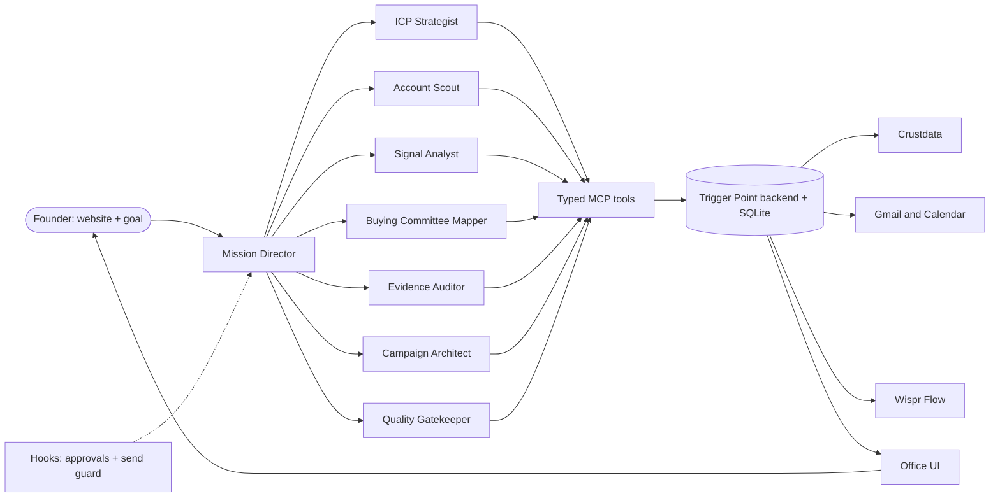

### The agents
Claude Code runs the agents. A Mission Director leads seven specialists. Each specialist has one job and a small tool list.

| Agent | Job |
|---|---|
| Mission Director | Runs the mission. Asks the specialists. Handles Gmail and Calendar. |
| ICP Strategist | Turns the profile into a strategy and an ideal customer profile. |
| Account Scout | Finds companies in Crustdata. |
| Signal Analyst | Finds dated signals for each account. |
| Buying Committee Mapper | Finds the people who own the problem. |
| Evidence Auditor | Checks each claim against its source. |
| Campaign Architect | Writes the message. |
| Quality Gatekeeper | Checks relevance, evidence, duplicates, and policy. |

### Models, tools, and data
- **Models.** Claude Code runs the agents. A Hyde gateway model (`hyde/glm-5.3-flash`) does extraction and drafting. A model never calculates a score.
- **Tools.** The agents use typed MCP tools. The tools change state only through the backend. Gated tools wait for a human or for Autopilot policy.
- **Hooks.** A hook holds each gated call. A send guard blocks every recipient that is not on the allowed list.
- **Data.** SQLite stores missions, evidence, drafts, replies, meetings, lessons, and strategy versions. Every strategy change is a new version. You can roll back.
- **Code.** Python 3.12, FastAPI, and Pydantic on the backend. React and Vite for the Office.
- **Tests.** More than 700 Python tests, 30 deterministic evals, and the UI tests run offline.

### Where it calls Crustdata
| Call | Used for |
|---|---|
| `GET /account/endpoints` | Checks which endpoints the key can use. |
| `POST /company/identify` | Excludes the seller from its own results. |
| `POST /company/search/autocomplete` | Free. Gives the exact spelling of an industry or a place. |
| `POST /company/search` | Finds accounts with industry, place, and size filters. |
| `POST /person/search` | Finds the buyer at each account. |
| `POST /job/search` | Finds hiring signals. |
| `POST /social_post/search` | Finds staff posts about a topic. Costs 0.5 credit for each post. |
| `POST /person/contact/enrich` | Looks up email and phone. Needs a key with contact access. |

The adapter validates each request and each response. It caches results, retries with backoff, stops at the credit budget, and records a receipt for each call.

---

## The approaches we tried

| Approach | Result | What we did |
|---|---|---|
| **Search by company hiring.** Look for job posts at schools. | Failed. Schools had 0 job posts and no funding. | Added a signal from staff posts about the topic. |
| **Match a post to a school by a part of the name.** | Failed. It matched other campuses of the same chain. | Match only an exact employer name. Say "matched by name" in the evidence. |
| **Let the model write the industry for the search.** | Failed. It wrote `primary/secondary education`. Crustdata needs exact case, so the search found nothing and fell back to coaching classes. | Resolve every name through the free autocomplete. Search both spellings. |
| **Filter by `Powai, Mumbai, Maharashtra, India`.** | Failed. No record uses this full text. | Widen the place one part at a time, from the street to the city. Never drop the industry. |
| **Let the model score accounts.** | Rejected. Scores changed between runs. | Score with code. The model only reads and writes. |
| **One large agent.** | Rejected. It mixed jobs and skipped checks. | A Director with seven specialists and typed tools. |
| **Learn from every send.** | Rejected. Test sends and demo data gave false lessons. | Learn only from real outcomes. A lesson needs two sources. |
| **Guess a parent from age.** | Rejected. It is unsafe and unfair. | Use only what a parent says about themself. Not built yet. |
| **A generic mass-email tool.** | Rejected. It is what buyers already ignore. | Few accounts. Each message has a dated, sourced reason. |

**Why we chose the built approach.** We want a founder to trust the result without a check of every step. So we made evidence, deterministic scores, and human approval the base. Autopilot then removes the routine clicks, and it keeps the decisions that change strategy.

---

## More help

### Project layout
```text
.claude/        agents, permissions, hooks
docs/           spec, audit, architecture, policies
evals/          deterministic evaluation cases
fixtures/       recorded data for replay mode
office/         the Office UI (React, Vite)
scripts/        office.sh, office_hook.py, fixture tools
src/trigger_point/   web, context, mission, research, scoring, cases,
                drafts, workflow, Office API, MCP server
tests/          Python tests
```

### Documents
| Read | For |
|---|---|
| [docs/GTMO_AUDIT_REPORT.md](docs/GTMO_AUDIT_REPORT.md) | What is true today, item by item |
| [docs/PROJECT_STATUS.md](docs/PROJECT_STATUS.md) | Features, limits, and decisions |
| [docs/ARCHITECTURE.md](docs/ARCHITECTURE.md) | How the parts fit |
| [docs/CRUSTDATA_INTEGRATION.md](docs/CRUSTDATA_INTEGRATION.md) | Crustdata facts we proved live |
| [docs/OUTREACH_POLICY.md](docs/OUTREACH_POLICY.md) | Rules for outside action |
| [docs/EVIDENCE_AND_VERIFICATION.md](docs/EVIDENCE_AND_VERIFICATION.md) | Evidence rules |
| [CLAUDE.md](CLAUDE.md) | Rules for anyone who changes this code |

### Troubleshooting
| Problem | Fix |
|---|---|
| The page says the token is missing | Open the link that `scripts/office.sh` prints. |
| Agents do nothing, or every tool is denied | Run `claude` once here. Accept the trust prompt. |
| `trigger_point` shows Pending approval | Run `claude` here. Approve the server. |
| The page looks old after a pull | Stop the Office. Run `scripts/office.sh` again. |
| Port 8000 is in use | Stop the other process. Check with `lsof -i :8000`. |
| A live mission stops at discovery | Set `CRUSTDATA_API_KEY` and `CRUSTDATA_MODE=live`. |
| Every account is rejected with `no_fresh_why_now` | The market has no public signal. This is correct. See [Where it still needs a person](#where-it-still-needs-a-person). |
| Autopilot waits and never replies | Add the two Calendar read tools to `permissions.allow`. |
| Test email is blocked | Add the address to `TRIGGER_POINT_TEST_RECIPIENTS`. Restart. |
| `replay_missing` | Fixture mode has no recording for this site. Use `supportpilot.example`. |

### Safety rules
- Real recipients do not receive mail. Mail goes only to the test addresses.
- An approval binds to the exact text. If you edit the text, the approval is void.
- Unknown stays unknown. Trigger Point does not invent a person, a signal, or a source.
- Code calculates every score.
- The API listens on the local machine only. Do not host it.
- Never commit `.env`, keys, personal data, or real prospect lists.

### Licence
The Office art comes from [Claude Office](https://github.com/W17ant/Claude-Office) under the MIT licence. See [docs/THIRD_PARTY_NOTICES.md](docs/THIRD_PARTY_NOTICES.md).
